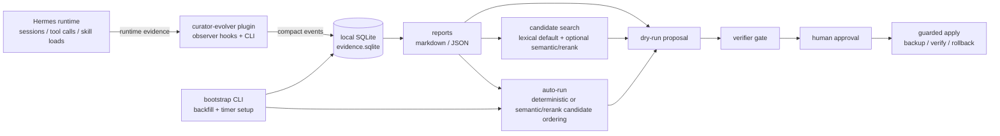

# Hermes Curator Evolver Architecture

`hermes-curator-evolver` is an evidence and proposal layer around Hermes skills. It does **not** replace native `hermes curator`. Autorun prepares review plans only: no native single-writer handoff is defined, so legacy apply/approval flags and allowlists cannot authorize unattended skill/reference writes. Explicit manual guarded apply remains a separate operation.

## One-page architecture



Review/inspection does not mutate the inspected evidence or skills. Collection, ingestion and bootstrap are explicit writers to their own stores/scheduler files, not read-only inspection. Manual `Apply` requires explicit approval and creates a rollback manifest; it is not an unattended native lifecycle handoff.

## What each part does

| Part | Role |
| --- | --- |
| Hermes runtime | Produces session/tool/skill activity signals. |
| `curator-evolver` plugin | Registers observer hooks, a report tool, a slash command, and CLI entry points. |
| SQLite evidence store | Keeps compact local evidence under `~/.hermes/plugin-data/curator-evolver/evidence.sqlite`. |
| Reports | Shows bounded activity/error/action summaries; these are not usefulness measurements. |
| Skill audit | Read-only structural scan for oversized `SKILL.md`, missing `references/`, very long inline lines, and executable support files. |
| Merge check | Read-only source→umbrella consolidation guard that blocks merges which would drop executable capacity such as `scripts/` or `.py`/`.sh` support files. |
| Candidate search | Finds likely related skills with lexical search by default; semantic models are opt-in only. |
| Proposal | Produces dry-run review artifacts grounded in evidence. |
| Bootstrap | One-command setup that backfills recent sessions and installs/enables the daily timer. |
| Auto-run | Selects evidence-backed physical review targets, optionally orders eligible targets with embedding/rerank, and prepares bounded notes/reference plans. Native visibility/disabled state can be unknown; this is not a canonical active-loader inventory. No unattended skill/reference writes occur without an explicitly defined native writer handoff. |
| Verifier | Blocks ungrounded, mutating, or destructive proposals. |
| Guarded apply | Writes reviewed content only after approval/hash/backup/verify gates. |

## Model usage plan

| Phase | Model | Used for | Default behavior |
| --- | --- | --- | --- |
| v0.1 | None | Evidence collection and report aggregation. | Local/read-only. |
| v0.2 | Hermes configured chat model | Drafting improvement proposals from evidence and existing skill text. | Optional `--draft-with-model`; dry-run artifact; no skill writes. |
| v0.2 | Deterministic verifier + future verifier prompt | Checking whether a proposal is grounded, safe, and non-destructive. | Blocks mutation by default. |
| v0.3/v0.5 | `Qwen/Qwen3-Embedding-0.6B` | Embedding skills, session evidence, and user corrections to find candidate skills. | Optional `--execute-semantic`; no default model download. |
| v0.3/v0.5 | `BAAI/bge-reranker-v2-m3` | Re-ranking candidate skills/evidence after embedding search, especially for Chinese/English mixed workflows. | Optional `--rerank`; no default model download. |
| v0.4 | Verifier + local validation command | Guarding reviewed content before it is applied. | Requires approval, backup, verification, and rollback path. |
| v0.6 | None by default | Automatic low-risk managed skill evolution from evidence. | Optional `auto-run` / `install-auto`; no Hermes core modification. |
| v0.7 | `Qwen/Qwen3-Embedding-0.6B` + `BAAI/bge-reranker-v2-m3` | Optional model-assisted autorun candidate ordering. | Explicit `--semantic-candidates --rerank-candidates`; models only reorder evidence-eligible candidates. |
| v0.9 | None | Provenance-safe auto-apply source classification. | Writes only local agent-created skills; skips bundled/official, hub, plugin, external, pinned, and unknown sources. |
| v0.10 | None by default | One-command `bootstrap` setup and compressed quick start. | `bootstrap` backfills sessions and installs/enables the timer; `bootstrap --semantic` is explicit model opt-in. |
| v0.11 | None | Size-bounded auto-apply preparation. | Targets a 90k `SKILL.md` soft cap, spills bulky evidence into `references/`, and skips already-over-100k skills. |
| v0.12 | None by default | Clean-room multi-variant candidate selection and staged verification inspired by HyperAgents concepts. | `--variants N` is deterministic/model-free; `--staged-verify` runs local structural checks before optional user-supplied verify commands. No HyperAgents dependency or model-generated code execution. |
| v0.14 | None | Skill structure audit and executable-capacity merge checks. | Read-only commands; no model call and no skill mutation. |

Notes:

- Chat/proposal/verifier text generation should follow the user's active Hermes provider configuration instead of being hardcoded in this plugin.
- Embedding/reranker models are candidate-generation aids only; they do not decide or apply edits by themselves.
- Semantic mode has a plan-only path (`--semantic`) and explicit execution paths (`--execute-semantic`, `--rerank`); no model is downloaded unless the user opts in.
- Auto-run semantic/rerank mode is also explicit opt-in (`--semantic-candidates`, `--rerank-candidates`) and can only reorder evidence-eligible candidates.
- For post-install operations and the current supported-model matrix, see [after-install.md](after-install.md).
- For the exact core algorithm and the current embedding/rerank boundary, see [core-algorithm.md](core-algorithm.md).

## Safety boundary

```mermaid
flowchart LR
    Evidence[collect evidence] --> Report[generate report]
    Report --> Proposal[dry-run proposal]
    Proposal --> Verify[verifier gate]
    Verify --> Approval[human approval]
    Approval --> Backup[backup + manifest]
    Backup --> Patch[write reviewed content]
    Patch --> Validate[optional validation command]
    Validate -. fail .-> AutoRollback[auto rollback]
    Validate -. pass .-> Done[done]
    Done --> ManualRollback[manual rollback available]

    classDef readonly fill:#dbeafe,stroke:#2563eb,color:#0f172a;
    classDef guarded fill:#fef3c7,stroke:#d97706,color:#0f172a;
    class Evidence,Report,Proposal,Verify readonly;
    class Approval,Backup,Patch,Validate,AutoRollback,Done,ManualRollback guarded;
```



Hard rules:

- Evidence/report/proposal/candidate commands do not mutate skills.
- `audit-skills` and `merge-check` are read-only structural checks. They exist to provide deterministic facts before any model or human consolidates skills.
- A source skill with executable capacity (`scripts/`, executable files, or `.py`/`.sh`/similar support files) must not be archived into a target that lacks equivalent executable support directories; use `merge-check` and preserve or demote support files explicitly.
- Candidate search is advisory.
- Semantic model execution is opt-in: `--semantic` is plan-only; `--execute-semantic` loads embeddings; `--rerank` loads the reranker.
- Auto-run model-assisted candidate ordering is opt-in: `--semantic-candidates` loads embeddings; `--rerank-candidates` loads the reranker and implies semantic candidate ordering.
- Semantic runtime is bounded for unattended use: ranking text is truncated (`HERMES_CURATOR_EVOLVER_SEMANTIC_TEXT_LIMIT`, default `512`), embedding batch size is `1`, and device can be forced with `HERMES_CURATOR_EVOLVER_SEMANTIC_DEVICE=cpu|cuda|auto`.
- If semantic/rerank execution fails, auto-run falls back to deterministic evidence ordering rather than crashing.
- Guarded apply requires exact target SHA256 and `--approve`.
- Guarded apply creates a backup and manifest before writing.
- Failed validation restores the backup automatically.
- Auto-run remains proposal-only even with both legacy apply flags. Ownership, native adoption, allowlisting and a successful restore drill never supply the missing native writer handoff.
- Bundled/Hub/external ownership is preserved; absent/corrupt policy state stays unknown. Native management opt-in is not authorship. Unknown-disabled entries may appear in physical review output, never as a claim of enabled/native-active status.
- Auto-run prepares bounded managed-block/reference plans while preserving existing source bytes. A refused apply is nonzero at the CLI.
- Optional restore-drill gate: every guarded apply now records provenance, an evidence-DB reference, any scheduler unit paths, and per-support-file snapshots into the manifest. `hermes-curator-evolver restore-drill --manifest <manifest>` replays that manifest into a clean temp directory (or an explicit empty `--target-dir`) and emits a machine-readable pass/fail JSON report. Pair with `auto-run --require-restore-drill` to refuse subsequent mutating apply when the last apply has no matching successful drill yet, or when the drill-state file is unreadable (default: warn only, never silent).

## Bounded ranking and event accounting

Ranking uses one read-only catalog snapshot for lexical/embedding/rerank paths and fallback. The adapter reuses supported already-loaded/injected native resolver functions over explicit roots, without plugin discovery or trusted-project quarantine scans. Strict app/environment gates and unavailable scopes remain unknown. Catalog/ranking source reads are bounded by the existing 100,000-character skill hard cap; structural auditing remains a separate physical measurement. Model inputs retain the 512-character default budget, including useful identity/description/body snippets rather than only leading YAML.

Vector/score cardinality, dimensions, finite numbers and nonzero vectors are validated. Failed embeddings fall back to lexical order; failed reranking keeps embedding order. Load, attempted call, validated completion and failure are separate. Reported encode/predict calls and input/pair counts are interface observations; `embedding_batches` follows the requested batch size of one, not measured backend internals. Scores are uncalibrated rankings, not confidence or usefulness.

Autorun discloses the evidence aggregate's top-20 cutoff and does not claim complete inventory ranking. Unambiguous aliases use a conservative maximum per-alias count instead of summing potentially overlapping invocations. Semantic ordering cannot promote an evidence-ineligible target.

One tool invocation and its child skill actions are separate counts. Per-skill aggregates count a parent invocation once per associated skill, not once per repeated action. Native status is primary; unknown provenance stays unknown, and batch rollback/contradictions cannot produce positively successful actions. Partial imports preserve successful earlier writes. Event attempts reconcile as imported + duplicates + failed; source/session failures are separate, and imported/failed session counts can overlap after partial persistence. These are operational observations, not outcome-quality measurements.

## Current commands

```bash
hermes-curator-evolver bootstrap
hermes-curator-evolver bootstrap --semantic
hermes-curator-evolver status
hermes-curator-evolver report --days 7 --format json
hermes-curator-evolver propose --skill hermes-agent --format json --output proposal.json
hermes curator-evolver propose --skill hermes-agent --skill-file ./SKILL.md --draft-with-model
hermes-curator-evolver verify --proposal-file proposal.json --skill hermes-agent
hermes-curator-evolver candidates --query "gateway restart" --skills-dir ~/.hermes/skills
hermes-curator-evolver candidates --query "gateway restart" --skills-dir ~/.hermes/skills --execute-semantic --rerank --format json
hermes-curator-evolver audit-skills --skills-dir ~/.hermes/skills --format json
hermes-curator-evolver merge-check --source ~/.hermes/skills/sangfor-devices --target ~/.hermes/skills/infrastructure --format json
hermes-curator-evolver apply --target ./SKILL.md --content-file ./reviewed-SKILL.md --expected-sha256 <sha> --approve
hermes-curator-evolver rollback --manifest .curator-evolver-backups/<timestamp>/manifest.json
hermes-curator-evolver restore-drill --manifest .curator-evolver-backups/<timestamp>/manifest.json --format json
hermes-curator-evolver auto-run --skills-dir ~/.hermes/skills --apply-low-risk --approve-auto-apply
hermes-curator-evolver auto-run --skills-dir ~/.hermes/skills --semantic-candidates --rerank-candidates --apply-low-risk --approve-auto-apply
hermes-curator-evolver install-auto --schedule daily --enable
hermes-curator-evolver install-auto --schedule daily --enable --semantic-candidates --rerank-candidates
hermes-curator-evolver uninstall-auto
```

The plugin also registers `curator-evolver` through Hermes plugin APIs for forward compatibility, but current Hermes builds may not expose it as `hermes curator-evolver ...` yet.
